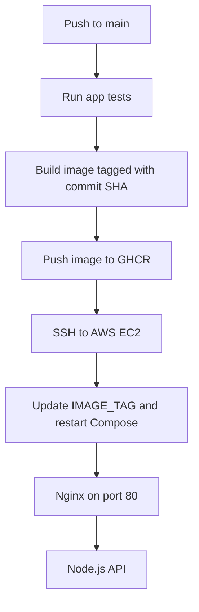

# DeployReady

Kora Analytics API deployed to AWS EC2 with Docker Compose, Nginx, GitHub Actions, and GitHub Container Registry (GHCR).

## Architecture



## Run locally

Requires Docker Compose.

```bash
docker compose -f compose.local.yaml up --build
```

The API is available at `http://localhost:3000`. Check it with:

```bash
curl http://localhost:3000/health
```

The API also provides `GET /metrics` and `POST /data`.

## CI/CD

On each push to `main`, GitHub Actions runs the application tests, builds and pushes a commit-SHA-tagged image to GHCR, then connects to the EC2 instance over SSH and updates the running Compose deployment.

Set these repository secrets for deployment:

- `DEPLOY_HOST`: 54.82.9.189
- `DEPLOY_USER`: `deploy` user limited access.
- `DEPLOY_SSH_KEY`: private SSH key

## Deployment and operations

See [DEPLOYMENT.md](./DEPLOYMENT.md) for the AWS setup, Docker installation link, GHCR image, and production commands. See [OBSERVABILITY.md](./OBSERVABILITY.md) for health checks, logs, and troubleshooting.
